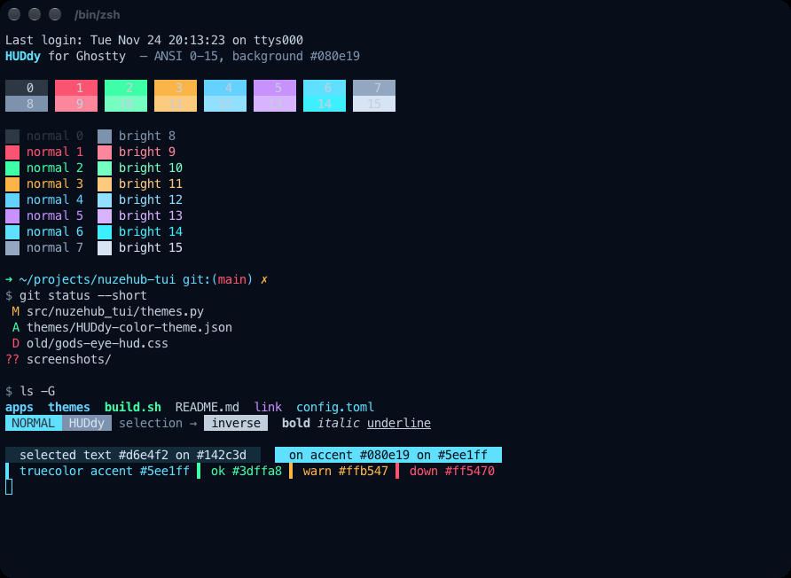
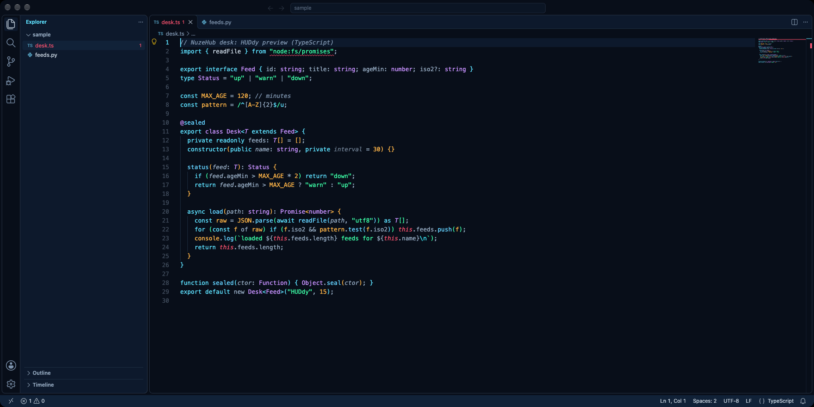
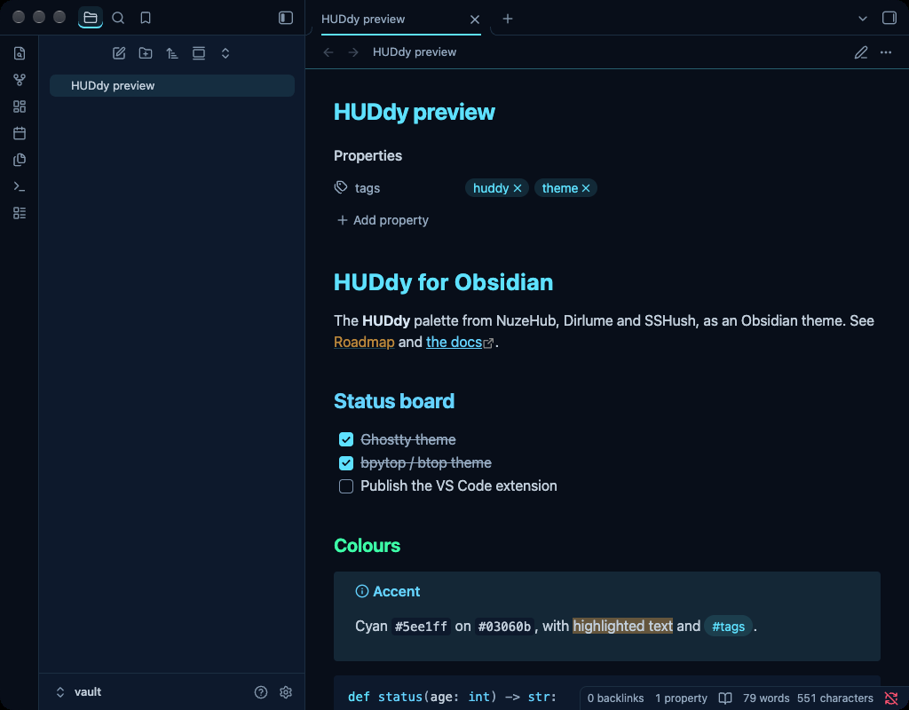
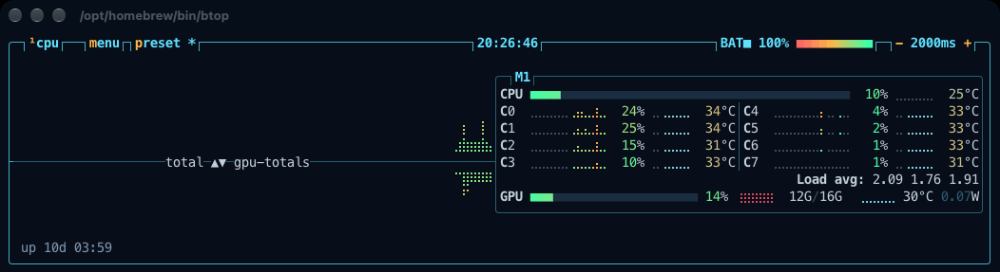
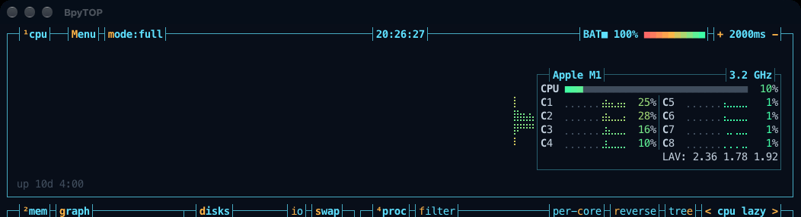

# HUDdy Themes

A dark heads-up-display colour scheme for Ghostty, VS Code, Obsidian, btop and bpytop. Soft-navy `#080e19` canvas, deeper navy panels, cyan `#5ee1ff` accent, and green, amber and red status colours. The same palette is used by SSHush and NuzeHub TUI.

This is **HUDdy Themes 1.1**, a colour-only update of 1.0: lifted near-black backgrounds, body text capped at `#c2cfdc`, and ink-high / selection text capped at `#d6e4f2`. Accents, status colours and hues are unchanged. There is no `#ffffff` in any theme file. Selected rows use dark text (`#080e19`) on the accent.





The source of truth is [HUDdy Soft Contrast Spec 1.0](docs/HUDdy-Soft-Contrast-Spec-1.0.md). Tokens are listed in [PALETTE.md](PALETTE.md). The [App Design Template 1.1](docs/design-template/App-Design-Template-1.1.md) describes how HUDdy apps are laid out and themed.

## Features

- One palette, generated once, copied into every target app so the colours match exactly.
- Ghostty 16-colour theme, cursor, selection and split colours.
- VS Code colour theme `davidprush.huddy-theme` (workbench, terminal ANSI, TextMate and semantic tokens).
- Obsidian community-format dark theme (`manifest.json` + `theme.css`).
- btop and bpytop themes, including graph gradients.
- Paste-once installers for macOS, safe to run again (existing files are backed up before a change).

## Requirements

- macOS is the intended platform for the paste-block installers (`base64 -D`, Ghostty paths, `code` CLI).
- [Ghostty](https://ghostty.org) 1.1 or newer for the terminal theme (recommended).
- Visual Studio Code, Obsidian, btop and/or bpytop, depending on which themes you install.
- No Python runtime is required to install or use the themes. Python is only needed if you regenerate them from `source/`.

Ollama and LM Studio are not used by these themes. The paste blocks report dock, Ollama and swap status first, then continue either way.

## Install

Each app has a paste block in [`paste-blocks/`](paste-blocks/). Working files go in `${TMPDIR:-/tmp}/huddy-themes-1.1`. Nothing is downloaded. Each file is checked with `shasum -a 256` before it is used. A file is only rewritten when its content would change, and is backed up first as `<file>.huddy-backup.<time>`.

Paste each block whole into zsh in Ghostty. It runs in a subshell, stops at the first error and leaves your shell as it was.

You can also copy the theme files by hand, as below.

### Ghostty

Copy [`ghostty/HUDdy`](ghostty/HUDdy) to `~/.config/ghostty/themes/HUDdy` and add `theme = HUDdy` to `~/.config/ghostty/config` (or `config.ghostty`). Or paste [`paste-blocks/huddy-ghostty.zsh`](paste-blocks/huddy-ghostty.zsh).

Then run `ghostty +list-themes` and confirm `HUDdy (user)` is listed. Restart Ghostty, or reload the config, to apply it.

### Visual Studio Code

The extension id is **`davidprush.huddy-theme`**.

- From the Marketplace: Extensions ‣ search for **HUDdy** ‣ Install, then Command Palette ‣ **Preferences: Color Theme** ‣ **HUDdy**.
- From this repo, package and install the extension in `vscode/huddy-theme/` (or install a built `.vsix` of version 1.0.1 if you have one):

```zsh
# if you have vsce
npx @vscode/vsce package --cwd vscode/huddy-theme
code --install-extension vscode/huddy-theme/huddy-theme-1.0.1.vsix
```

Or paste [`paste-blocks/huddy-vscode.zsh`](paste-blocks/huddy-vscode.zsh).

Semantic highlighting is on, so languages with a semantic token provider (TypeScript, Python with Pylance, Rust, Go and others) get richer colouring for types, parameters and read-only values.

### Obsidian

Copy [`obsidian/HUDdy/`](obsidian/HUDdy/) into `<your vault>/.obsidian/themes/HUDdy/`, then pick **HUDdy** in Settings → Appearance → Themes. Or paste [`paste-blocks/huddy-obsidian.zsh`](paste-blocks/huddy-obsidian.zsh). Dark mode only: if Obsidian is set to Light, it uses its own light colours.



### btop and bpytop

Copy [`btop/huddy.theme`](btop/huddy.theme) to `~/.config/btop/themes/huddy.theme` and set `color_theme = "huddy"` in `~/.config/btop/btop.conf`.

Copy [`bpytop/huddy.theme`](bpytop/huddy.theme) to `~/.config/bpytop/themes/huddy.theme` and set `color_theme="+huddy"` in `~/.config/bpytop/bpytop.conf`.

Or paste [`paste-blocks/huddy-bpytop-btop.zsh`](paste-blocks/huddy-bpytop-btop.zsh). Run them inside Ghostty with the HUDdy Ghostty theme for the same chrome.





## Palette

| Role | Colour |
| --- | --- |
| Background | `#080e19` |
| Surface / panels | `#0d192c` / `#112138` |
| Body text | `#c2cfdc` |
| Ink-high (headings, ANSI 15, selection text) | `#d6e4f2` |
| Muted text | `#7d93ad` |
| Accent cyan | `#5ee1ff` |
| Text on accent | `#080e19` |
| Selected tint | `#142c3d` |
| OK / warn / danger | `#3dffa8` / `#ffb547` / `#ff5470` |

Body text on the background is 12.19:1; ink-high on the selected tint is 9.09:1; text on accent is 12.59:1. The full token table and ANSI palette are in [PALETTE.md](PALETTE.md).

### Truecolor note

Ghostty and the VS Code integrated terminal use the 24-bit values above. Over ssh, forward `COLORTERM=truecolor` (or use a terminal that SSHush and NuzeHub TUI already detect, such as Ghostty) so `#080e19` arrives exact. `NO_COLOR` should be left unset if you want the theme colours.

## Configuration

- **Ghostty:** `theme = HUDdy` in `~/.config/ghostty/config`. The paste block wraps this in a managed `# >>> huddy-theme >>>` section so a second paste replaces it rather than duplicating it.
- **VS Code:** Color Theme ‣ HUDdy. The workbench and terminal colours come from `vscode/huddy-theme/themes/HUDdy-color-theme.json`.
- **Obsidian:** Settings → Appearance → Themes ‣ HUDdy (dark mode).
- **btop / bpytop:** `color_theme` as above. Selected process rows use the accent with dark text.

## Troubleshooting

- **Ghostty still shows another theme.** A config in `~/Library/Application Support/com.mitchellh.ghostty/` loads later than `~/.config/ghostty/config`. Check `ghostty +show-config` and that `theme = HUDdy` is the last theme line.
- **VS Code theme does not appear.** Confirm the extension id is `davidprush.huddy-theme` and that you selected the **HUDdy** colour theme, not only installed the extension.
- **Obsidian looks light.** Switch Obsidian itself to dark mode; this theme does not provide a light variant.
- **btop or bpytop still uses the default.** Confirm the theme file is in the `themes/` folder named `huddy.theme` and that `color_theme` matches the names above, then restart the app.
- **Colours look washed out over ssh.** The remote session may be 256-colour only. Use Ghostty and ensure truecolor is advertised (`echo $COLORTERM` should be `truecolor`).

## Project structure

```
ghostty/               # Ghostty theme file + LICENSE
vscode/huddy-theme/    # VS Code extension (davidprush.huddy-theme)
obsidian/HUDdy/        # Obsidian community theme
btop/  bpytop/         # huddy.theme for each
paste-blocks/          # macOS zsh installers
screenshots/           # Ghostty, VS Code, Obsidian, btop, bpytop
source/                # palette + generators
docs/                  # Soft Contrast spec
docs/design-template/  # App Design Template 1.1
PALETTE.md             # token table
```

## Contributing

Theme files are generated from [`source/palette.py`](source/palette.py) by [`source/gen.py`](source/gen.py). Edit the palette (or the Soft Contrast spec), regenerate, and check that no theme file contains `#ffffff` and that accents are unchanged. Please keep the four apps in lock-step.

```zsh
python3 source/gen.py    # from the repo root, after reading source/gen.py
```

## License

MIT, Copyright (c) 2026 David Rush. See [LICENSE](LICENSE). Individual theme folders also include a copy of the license.
