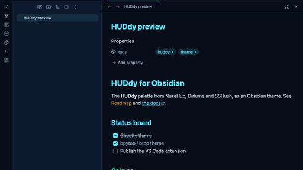

# HUDdy

A dark heads-up-display theme for Obsidian, from the HUDdy palette used by NuzeHub, Dirlume and SSHush: a soft-navy `#080e19` canvas, navy panels and a cyan `#5ee1ff` accent, with green, amber and red status colours.

- Dark mode only. If Obsidian is set to Light, it uses its own light colours.
- Headings use the accent, midnight blue, green, amber and two greys (H1 to H6).
- Tags, links, callouts, checkboxes, code blocks and the graph view all follow the palette.
- Version 1.1.0 applies the HUDdy Soft Contrast values: lifted backgrounds, body text `#c2cfdc`, bold/ink-high `#d6e4f2`, and dark text on accent fills.

Matching HUDdy themes exist for VS Code, Ghostty and bpytop/btop.

## Install by hand

Copy `manifest.json` and `theme.css` into `<your vault>/.obsidian/themes/HUDdy/`, then pick **HUDdy** in Settings → Appearance → Themes.

## License

MIT © David Rush
